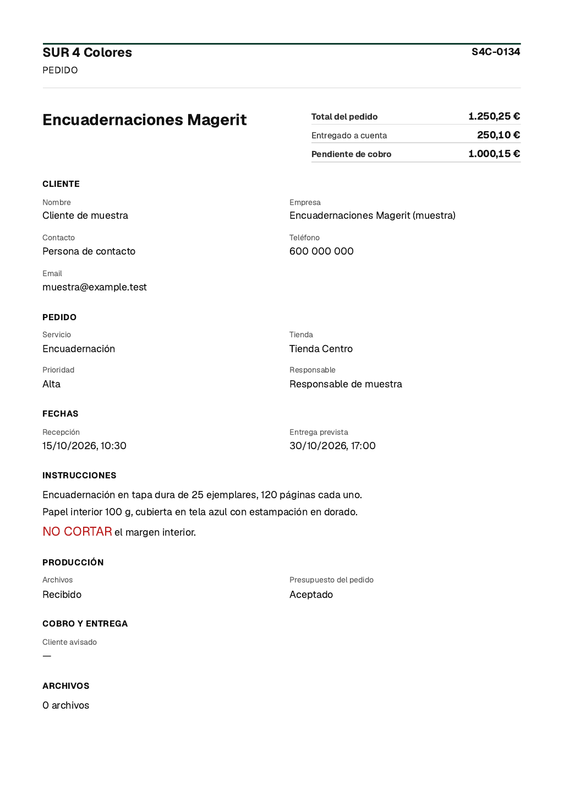
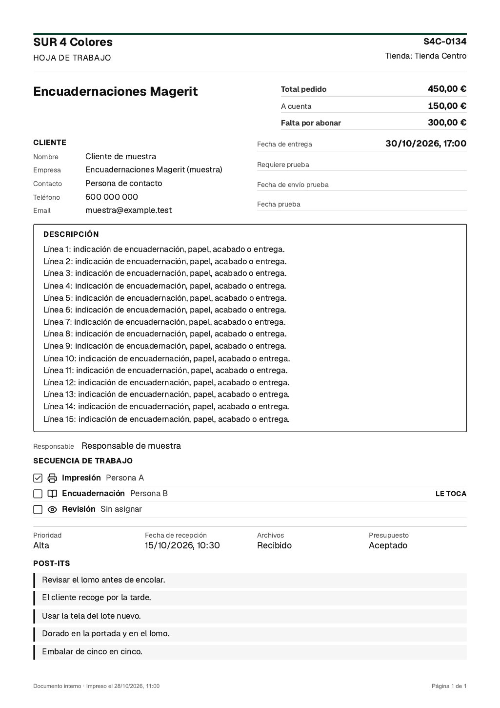

# Hoja de trabajo: resumen económico superior

Petición de Tamara trasladada por el propietario el 30/10/2026. Base revisada: `main` en `f4e0ab5` (PR #168). Pendiente de revisión y GO del propietario antes de fusionar o publicar en Production.

## Resultado

«Imprimir pedido» muestra el título a la izquierda y, arriba a la derecha, un único bloque con líneas: Total del pedido, Entregado a cuenta y Pendiente de cobro. Los nombres siguen `orderLabels`, igual que el Resguardo, conservando las etiquetas personalizadas cuando corresponda.

Aplica al perfil `standard` que el encargo identifica como activo en SUR4 (`order_work_sheet_ficha` apagado), a los demás tenants y al perfil `ficha` cuando se active. No se ha consultado ni cambiado ningún grant remoto. Esta petición amplía el contrato N25 anterior: el estándar conserva sus bloques y añade el resumen de cobro; no se activa el perfil ficha.

- `loadWorkSheet` lee `order_collection_v1` una vez en ambos perfiles, después de comprobar sesión y pertenencia del pedido al tenant.
- `WorkSheetModel.amounts` se construye mediante `amountFacts` y `formatOrderMoney`, los mismos que el Resguardo. No se recalcula ni se suman pagos en el frontend.
- Una sola cabecera presenta ese modelo en ambos perfiles. Se retira el antiguo bloque exclusivo de `ficha` para no duplicarlo.
- Fechas, estado de pago, método de entrega, aviso al cliente, archivos y exclusiones de notas internas se conservan. Secuencia y Post-it autorizados mantienen su contenido y reglas de acceso.
- La ficha fija la altura de línea de sus datos y títulos para conservar el caso de aceptación de 15 líneas, 3 pasos y 5 Post-it en una A4, incluso con los estilos globales de la app.

El Resguardo PDF del cliente conserva su cargador, su modelo y su renderizador. Ningún cambio en Stripe, migraciones, funciones SQL, grants, datos ni despliegues. Sin comunicaciones a Tamara. Fuentes: arquitectura compartida de `sources/`, `docs/SUR4-FICHA-POSTITS-CONTRATO.md`, ADR de 27/10, código de `lib/print` y `components/print`.

## Evidencia visual

Datos inventados de las muestras existentes; no son pedidos ni datos personales de SUR4. Imágenes rasterizadas desde los PDF finales del navegador, después de las comprobaciones A4.

### Perfil estándar, anticipo parcial, app en modo oscuro

Total 1.250,25 €, a cuenta 250,10 €, pendiente 1.000,15 €. El papel permanece blanco y los textos oscuros.



### Perfil ficha, muestra completa

Una A4: 15 líneas de instrucciones, 3 pasos y los 5 Post-it imprimibles. Conserva recepción, fecha de entrega y campos de prueba. En esta muestra se usan las etiquetas personalizadas existentes.



## Pruebas

Entorno local, Node 22.23.2 y dependencias con el mismo `package-lock.json` de la base. Ninguna conexión con Supabase, Vercel o datos de producción para las pruebas funcionales. El navegador rechaza cualquier petición de red.

- Impresión y Resguardo: **80/80**, incluidas las pruebas del PDF de cliente y sus exclusiones.
- Suite completa con `TZ=UTC`, igual que el CI: **1.621 PASS**, **6 SKIP**, **0 FAIL** (1.627 casos). El primer intento con la zona horaria local detectó la expectativa UTC de una prueba existente del kiosco; con la configuración del CI pasa, sin modificarla.
- TypeScript y compilación de producción local (`next build`, Turbopack): sin errores. La compilación descarga la fuente Geist de Google; no publica ni utiliza Supabase Production.
- ESLint: sin errores; cuatro advertencias existentes de variables no usadas en `lib/orders/quote-situation.test.ts`.
- Navegador: **14/14** combinaciones de muestra/tema. Cada una comprueba escritorio (1.280 px), móvil (390 px), impresión desde viewport estrecho, disposición título/resumen, contraste, ausencia de desbordamientos y líneas visibles.
- **14 PDF de una A4**, también verificados con la fuente Geist latina real de la compilación, incrustada sin red, con importes y etiquetas verificados por extracción de texto: anticipo parcial con céntimos, sin anticipo y pago completo en los dos perfiles y los dos temas, más ficha completa en claro y oscuro. Fechas presentes, importes una sola vez, sin barra ni aviso de notas en papel.
- Pruebas del cargador: ambos perfiles y las dos variantes de etiquetas; total cero y sin definir; error o respuesta denegada del cobro (se imprime «—», nunca un falso cero); sesión ausente y pedido ajeno sin consultar el cobro. Los testigos de datos privados siguen excluidos.

Comandos reproducibles, desde la raíz del repositorio:

```sh
TZ=UTC node --import tsx --test
node --import tsx --test lib/print/*.test.ts lib/print/receipt-pdf/*.test.ts
npx tsc --noEmit
npm run lint
npm run build
```

Prueba de navegador, con Playwright instalado fuera del proyecto y Chromium disponible (no añade dependencias al producto). Requiere `pdftotext` de Poppler:

```sh
PLAYWRIGHT_MODULE=/ruta/a/playwright/index.mjs \
SMOKE_OUTPUT_DIR=/tmp/worksheet-payment-summary-evidence \
node scripts/worksheet-payment-summary-smoke.mjs
```

Para usar la fuente exacta de la app, añadir `PRINT_FONT_FILE=/ruta/a/la/fuente-latina.woff2` del resultado de `next build` (identificada como Geist latin en el CSS generado). Sin esta opción se comprueba la fuente de respaldo del sistema.

Si el ejecutable no está en la caché estándar de Playwright, añadir `CHROMIUM_EXECUTABLE_PATH=/ruta/a/chromium`. El script genera los HTML, capturas, PDF y `results.json` fuera del repositorio. La evidencia comprueba el componente real con los estilos globales compilados, sin iniciar sesión en una instalación remota.

## Límites de la validación

No se ha hecho una prueba con una sesión real de SUR4 ni una impresión física. Los importes de producción proceden de la misma RPC existente y autorizada que ya usa el Resguardo; las pruebas usan respuestas controladas de ese contrato. Pedidos más largos pueden paginar de manera normal; el resumen permanece completo en la primera página. La captura original no estaba disponible en la conversación recuperada: se ha seguido la descripción explícita del propietario.
